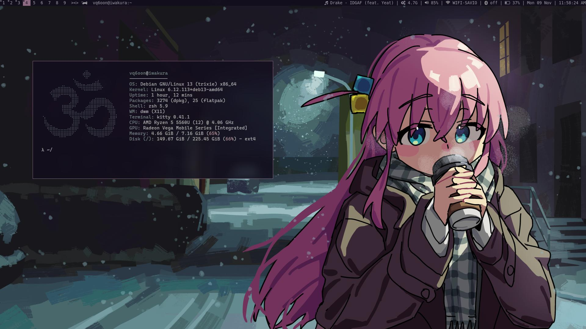

# dotfiles

Personal config repo. `dwm` and `sxstatus` are Git submodules, so GitHub shows links to their source repos. Other configs live here as normal tracked files.

## What's included

- `dwm/` and `sxstatus/` — submodules for https://github.com/vq6oon/dwm and https://github.com/vq6oon/sxstatus
- `.zshrc`, `.vimrc`, `.xsessionrc`
- `.config/kitty`, `.config/mpv` (including `scripts/autosave.lua`), `.config/nvim`
- `.config/dunst`, `.config/picom`, `.config/fastfetch`, `.config/yt-dlp`, `.config/dmenu/config.h`
- `.local/bin/theme*` and `.config/wal/templates/` — wallpaper theme scripts and pywal templates
- `screenshots/dwm.jpg` — DWM preview

## Screenshot



The installer links tracked files into `$HOME`. It does not copy `.gitconfig`, `.zshenv`, `.zprofile`, `.config/mov-cli`, credentials, or runtime state. Review those separately before adding. `dwm` and `sxstatus` keep their own history and remotes.

## Install

On a fresh machine:

```zsh
git clone --recurse-submodules https://github.com/vq6oon/dotfiles.git ~/Repository/dotfiles
cd ~/Repository/dotfiles
zsh install.zsh
```

Then start a new Zsh session. The installer creates symlinks such as `~/.zshrc -> ~/Repository/dotfiles/.zshrc` and `~/.config/dwm -> ~/Repository/dotfiles/dwm`. It checks every destination before creating links; existing files, folders, or unrelated symlinks make it stop without overwriting them. Back up or move conflicting paths, then rerun.

For a clone made without submodules:

```zsh
git submodule update --init --recursive
zsh install.zsh
```

## Edit and update

Edit the regular dotfiles in this repo; symlinks make those changes active. Commit them here. DWM-specific source, keybindings, build files, and documentation stay in `dwm/`. Wallpaper theme helpers and shared picom configuration live in this dotfiles repo.

Work on `dwm` and `sxstatus` inside their submodule directories. Commit and push changes to each submodule's own repo, then update the recorded submodule commit in this repo:

```zsh
git -C dwm status
git -C sxstatus status
```

After pulling new upstream commits, commit the updated submodule pointers in the dotfiles repo. Avoid adding generated binaries, caches, machine-specific paths, or secrets.
